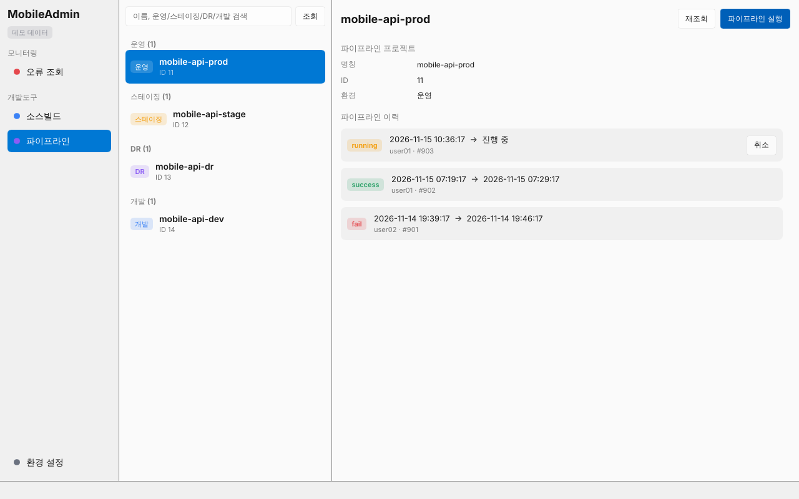

# MobileAdmin (Rust + Slint)

`MobileAdmin`(SwiftUI) 앱의 일부 기능을 **Rust + [Slint](https://slint.dev)** 로 옮긴 데스크톱 버전입니다.
macOS · Windows · Linux 에서 동작합니다.



## 들어 있는 기능

| 기능 | 내용 |
|---|---|
| 환경 설정 | 개발/운영/로컬 서버 URL, 관리자 CI 저장. 설정이 없으면 첫 실행 때 이 화면부터 뜹니다 |
| 로그인 | `/simpleLoginForAdmin` 으로 JWT 발급, 만료 시 자동 갱신, 401 이면 1회 재시도 |
| 오류 조회 | 기간 조회(오늘/3일/7일/30일), 설명·코드·사용자·URL 검색, 상세(Request Info, Trace), 삭제 |
| 소스빌드 | 운영/스테이징/DR/개발 분류와 검색, 프로젝트 정보, 최근 빌드 이력 5건, 빌드 실행 |
| 파이프라인 | 운영/스테이징/DR/개발 분류와 검색, 최근 이력 5건, 실행, 진행 중인 건 취소 |

아직 옮기지 않은 기능: 상품, 교육과정, 공통코드, 토스트, 마감부서, 배포, 커밋, 사용자 로그/타임라인, 서버 로그, 업로드 탐색.

## 실행

```bash
cargo run --release            # 실제 서버에 연결
MOBILEADMIN_DEMO=1 cargo run   # 서버 없이 샘플 데이터로 화면 확인
cargo test
```

Linux 는 `libxkbcommon-x11`, `fontconfig` 와 한글 글꼴이 필요합니다.

## 설정

- 설정 파일: OS 설정 폴더의 `mobile-admin/config.json` (Linux `~/.config`, macOS `~/Library/Application Support`). 화면 하단에 실제 경로가 표시됩니다.
- **관리자 CI 는 소스에 넣지 않습니다.** 환경 설정 화면에서 입력하거나 환경변수 `MOBILEADMIN_ADMIN_CI` 로 지정합니다.
  설정 파일에 평문으로 저장되며(Unix 는 권한 600), 환경변수가 있으면 그 값이 우선합니다.

## 구조

```
ui/app.slint      화면 (메뉴 | 목록 | 상세 3단, 환경 설정, 실행 확인 창)
src/main.rs       화면 상태와 이벤트 처리 (Swift 의 ViewModel + View 로직)
src/api.rs        토큰 관리와 API 호출 (NetworkClient + *Service)
src/models.rs     API 응답 모델
src/env_type.rs   프로젝트 이름 → 운영/스테이징/DR/개발 판별 (SourceEnvType)
src/config.rs     환경 설정 저장/불러오기 (EnvironmentModel)
src/demo.rs       데모용 샘플 응답
```

UI 는 메인 스레드, API 호출은 tokio 런타임에서 실행하고 결과만 이벤트 루프로 돌려보내 반영합니다.
